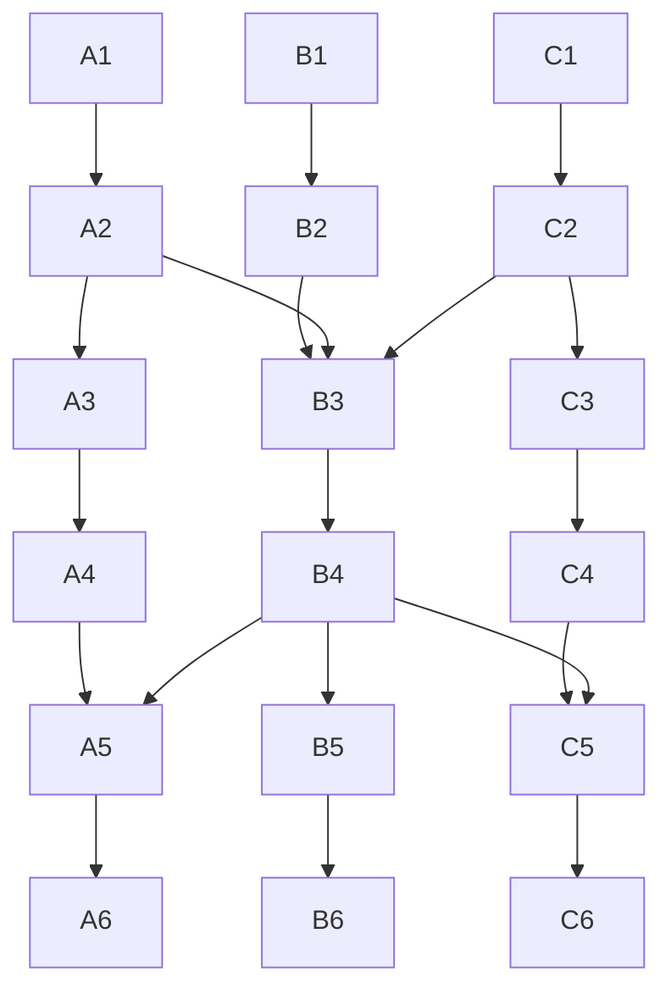

# Warrior, Wizard and Taoist talent overhaul

**Design draft.** Warrior, Wizard and Taoist each have a shared class tree and three specialisation trees. Every spec has six original spells, twelve original passive talents, three distinct buffs, three distinct debuffs, its own crowd control and its own counter. One chosen rotation engine changes how the spec earns and spends its burst proc. Names, level grants and numbers are starting points for playtesting.

- [Progression and tree rules](#progression-and-tree-rules)
- [Rotation and proc rules](#rotation-and-proc-rules)
- [Warrior](#warrior) · [Wizard](#wizard) · [Taoist](#taoist)
- [Combat and effect rules](#combat-and-effect-rules)
- [Talent window and skill UI](#talent-window-and-skill-ui)
- [Client, server and save rollout](#client-server-and-save-rollout)
- [Implementation sequence](todo.md)

The current game already has nine spec identities, nine signature actions, combo tracking, and three automatic traits per spec. This plan keeps the identities and expands the signatures into build choices. Entrapment and Lion Roar move from Stoneguard to the Warrior class kit. The legacy spell audit describes the original behaviours and rank gates. [Current spell homes](../Shared/SpellCurriculum.cs#L232) · [Signatures and traits](../Shared/SpecialisationAbilities.cs) · [Combo rules](../Shared/SpellCombos.cs) · [Legacy spell audit](../Docs/Spell-Progression-and-Specialisations.md)

## Progression and tree rules

| Level | Class points | Active spec points | What opens |
| --- | ---: | ---: | --- |
| 10 | 1 | — | First shared class talent |
| 20 | 4 | 1 | Choose a spec, gain its starter kit, buy a first spec talent |
| 23 | 5 | 2 | Spec's control action |
| 26 | 6 | 3 | Spec's counter-control action |
| 29 | 7 | 4 | Spec's proc finisher and default trigger |
| 32 | 8 | 5 | First spec branch spell choice |
| 35 | 9 | 6 | First choice of a rotation engine |
| 46 | 13 | 9 | First class capstone purchase |
| 52 | 15 | 11 | Full class budget |
| 62 | 15 | 15 | First spec capstone purchase |
| 71+ | 15 | 18 | Full spec budget |

Class points arrive every three levels from 10 through 52. Spec points arrive every three levels from 20 through 71. Unspent points can be banked. Level 20 grants the signature, builders and first original action. The six original spec spells comprise four level grants and two talent actions at A3 and C3. Both talent actions can be taken in the same build. Talent ranks and spell proficiency advance separately. Earlier legacy grants start at rank 0 and use the existing proficiency gates and saved progress.

Class trees have six rows. Spec trees have eight. Each row has three positions. A row-two node has two ranks. Every other purchase costs one point, including a choice from the options in its cell. Ranks count toward spend gates. Each tree allows one capstone. Each spec tree also allows one rotation engine in row 4.

| Tree | Required points spent in earlier rows |
| --- | --- |
| Class | Row 3 needs 4, row 5 needs 9, capstone row 6 needs 12. |
| Spec | Row 3 needs 4, engine row 4 needs 5, row 5 needs 6, row 6 needs 10, row 7 needs 12, capstone row 8 needs 14. |

Buy the full prerequisite node to follow an arrow. Finishing any option in a choice node satisfies its outgoing links. Both trees let B3 accept A2, B2 or C2. The class tree has direct links down each column and additional links from B4 to A5 and C5.



In a spec tree, finish any row 3 node to choose **any** row 4 engine. Row 5 needs the chosen engine and the row 3 node in that column. A6 can follow A5 or B5, and C6 can follow C5 or B5. Rows 7 and 8 follow their own column. An engine can therefore pair with a different column's capstone. Every engine runs using the guaranteed kit. Optional spells give the build more ways to use the resulting window.

The class tree layout and its applied allocation carry across all three specs. Each spec saves its own allocation and action-bar layout. Applying a refund also refunds downstream nodes that lose their last valid path or fall below a spend gate. Show the full refund and any removed actions before Apply. Let players inspect and draft any tree in preview. Apply talents, change spec and reset at a class trainer in a safe area after ten seconds out of combat, including combat involving the actor's companion. Initial selection is available out of combat at level 20. Resets are free during rollout.

The two-pane layout, incoming arrows, ranked nodes and choice nodes draw on the screenshots and Blizzard's published class and specialisation tree structure. The point cadence, capstone limit and Mir skill rules here are specific to this plan. [Blizzard's talent preview](https://worldofwarcraft.blizzard.com/en-gb/news/23797209/world-of-warcraft-dragonflight-talent-preview)

### Reading the trees

**New** grants an original castable action. **Unlock** grants a legacy action or passive. A **choice** buys one option. An **upgrade** changes an existing action and takes over its binding when it has a different spell ID. A **passive** is an ongoing rule while the talent is active. Each spec's 12 original passives are in rows 2, 4, 6 and 7. The three engines are separate passive designs with one active at a time. The other nine are normal talent picks. The three listed buffs and three listed debuffs are additional combat effects. Temporary control, immunity, and proc-readiness indicators have their own entries. An **aura** affects eligible actors while its source and area condition hold. A **mark** belongs to a particular caster and target and can be spent by an eligible spell.

Spell cards use initial PvE range and cooldown targets. Grid distances are in tiles. The spell's cast range, affected cells and light radius are independent. Powers, mana costs and PvP coefficients belong in balance data and will be calibrated against existing gear and encounter timings.

For an **18-point sample build**, take rows 1–3 and 5–8 in the main column, one engine in any column, rows 1–3 and 5–6 in a second column, and rows 1–2 in the third. Buy both ranks of row 2. Spend in earlier rows first to meet the gates.

For a **six-spell build** with an A or C capstone, take A and C through rows 1–3 and 5–6, one engine, B1 and B2, then row 7 and the chosen capstone. For the B capstone, take B through rows 1–3 and 5–8, one engine, A and C through row 3, and either A5 or C5. Pick the original spells in A3 and C3 when those nodes offer alternatives. Prioritising A3 and C3 makes all six available from level 41. Taking the engine first trades some early spell breadth for an earlier rotation choice.

## Rotation and proc rules

Each spec has two combat layers. The existing combo builds a charge or mark for the spec's normal payoff. A separate **rotation proc** lights up a new finisher after the confirmed events in the specified order. The level-29 default trigger gives each spec a working finisher before talents. Buying a row 4 engine replaces that trigger and changes the finisher's payoff. The finisher can be damage, protection or effective healing depending on the build.

- Read an arrow sequence as ordered server-confirmed events within the stated window. The window starts at the first event and covers earning the proc. Check for a valid next step before treating an event as a new opener. A matching opener can then restart an unfinished sequence. Unrelated legal actions leave progress in place. On target-bound routes, record the target when the recipe selects it and use that target for the finisher unless the recipe explicitly names a different target or tile.
- Proc readiness holds one charge for six seconds. Start with a 12-second finisher cooldown unless a spell card says otherwise. A new sequence can start once the prior charge is consumed or expired and the finisher is off cooldown. Consume the ready charge when the server accepts a legal cast. A failed preflight leaves it ready. A later miss keeps the paid cost and cooldown. Ordinary combo stacks remain separate.
- An originating cast or ordinary attack can advance at most one step, including its primary and delayed hits. A field tick is attributed to the cast that placed it. A ward absorption or mitigation step is attributed to the real incoming attack, so creating the ward and absorbing a later attack can be separate steps. Triggered copies, retaliations, finishers and copied poison give no proc credit. A recipe can explicitly use one effective Wick transfer, pet attack, dispel or legacy toggle outcome. Use ability families for eligible variants of a builder or payoff.
- Track source actor, target or tile where relevant, cast ID, first-event time and loadout revision on the server. Clear unfinished steps and ready charges on death, map change or build change. Clear target-bound charges when the target is gone. Sync the current step, time left, target and ready state to the HUD. The hotbar distinguishes an earned finisher, a waiting finisher and a cooling-down finisher. A build designed for packs or dispels keeps its normal combo in encounters where the finisher's trigger is absent.

## Warrior

Warrior fights with weapon damage and tile positioning. Iron Vow wants a two-tile opening against a priority target. Red Tempest wants a moving pack and clean sweep angles. Stoneguard wants to intercept a pull, keep enemies facing away from the party, and time its protection.

### Shared Warrior tree

Every Warrior receives **Fencing** and **Steel Cut** at 1, **Shoulder Dash** at 10, **Entrapment** at 12 and **Lion Roar** at 16. Entrapment remains an eligible-monster pull. Lion Roar remains eligible-monster control. Fencing is a passive and appears in the skill UI's Passive section. [Current dash](../Server/MirObjects/HumanObject.cs#L5016) · [Entrapment](../Server/MirObjects/HumanObject.cs#L6344) · [Lion Roar](../Server/MirEnvir/Map.cs#L1401)

| Row | A · Footwork | B · Command | C · Survival |
| --- | --- | --- | --- |
| 1 | **Ready Stance** — Steel Cut family gains accuracy on the first strike after a legal step. | **Battle Drill** — a confirmed Steel Cut after an avoided melee swing costs less MP. | **Braced Feet** — after a brief standstill, soften the next frontal melee hit on a short internal cooldown. |
| 2 · 2 ranks each | **Runner's Breath** — reduce Shoulder Dash recovery by 5/10% when it travels at least two tiles. | **Clear Voice** — reduce Entrapment and Lion Roar cooldowns by 5/10%. | **Fencer's Guard** — a landed Steel Cut family strike grants +1/+2 AC for two seconds. |
| 3 | **Dash Discipline** — choose **Long Stride**, **Battering Dash** or **Crowdbreaker**. | **Rallying Standard** · New — place a banner that grants nearby allies a steadying aura. | **Iron Stomach / Grip the Ground** — choose stronger emergency potion recovery at low health or shorter ordinary PvE slows. |
| 4 | **Rapid Recovery / Trail Guard** — shorten the post-dash action recovery, or gain a brief personal ward after travelling at least two tiles. | **Wide Roar / Rousing Roar** — trade paralysis duration for a wider PvE Roar, or give nearby allies a brief snare-resistance buff when Roar affects a monster. | **Second Wind** — taking a hit below 40% health starts a small recovery over time, once per 30 seconds. |
| 5 | **Driving Foot** — after moving at least two tiles with Shoulder Dash, the next Steel Cut family strike gains a small impact bonus. | **Hunter's Hook** — extend Entrapment's range by one tile and reduce its recovery after a successful pull. | **Close Formation** — fighting beside a party member briefly reduces incoming frontal physical damage to the Warrior. |
| 6 | **Vanguard's Pace** — a Shoulder Dash that travels at least two tiles without a collision gives nearby allies a short move-speed buff. | **Banner Lord** — extend Standard's radius from two to three tiles and retain its aura for two seconds after leaving it. | **Stand Firm** — brace against the next ordinary hostile shove, once per 30 seconds. Scripted encounter movement keeps priority. |

**Dash Discipline**

| Pick | Change | Trade-off |
| --- | --- | --- |
| Long Stride | Add two travel tiles. At legacy rank 3 the nominal range goes from 5–6 to 7–8 tiles. | Keep the original single-target shove distance and damage. Obstacles or an enemy that can no longer be pushed end the dash early. |
| Battering Dash | Cap travel at two tiles and add 40% to the first confirmed dash hit in PvE. PvP impact gets its own coefficient. | Short reach. It needs a legal collision and retains the target and push checks. |
| Crowdbreaker | Keep normal travel. Move up to three eligible normal PvE enemies in a contiguous line, checking the farthest destination first at each step. | Every move in the step must fit. An illegal destination stops the step. PvP uses the normal single-target rule. |

**Rallying Standard** · Place within two tiles, 28-second cooldown. The standard lasts six seconds and gives allies within two tiles a modest incoming-slow duration reduction. One standard per Warrior. The strongest overlapping Standard aura applies and its icon shows the source. A square-footed bronze flag identifies the aura boundary.

### Iron Vow · Precision melee and boss pressure

**Spec kit at 20.** Thrusting, Flaming Sword, Notchbreaker and **Arcane Hammer**. Thrusting at two tiles and a landed Flaming Sword create **Opening**, a single mark for 6.5 seconds. Use Notchbreaker for a quick far-tile payoff or Hammer for a stronger committed impact. A payoff spends the mark on a confirmed hit. Melee uptime and getting the angle right matter more than pack size.

| New action | Rules and feel |
| --- | --- |
| **Arcane Hammer** · Spec grant | Enemy at one or two tiles, 10-second cooldown, 420 ms wind-up. Project a rune-forged hammer from the equipped weapon and land a heavy DC strike against AC. With Opening, apply **Cracked Plate**, a short, modest physical armour debuff, and spend the mark. A narrow ground line shows the reach and the hammer lands on the confirmed tile. |
| **Oathbrand** · A3 | Replace Steel Cut while selected. Adjacent cut, 5-second cooldown. Stamp a four-second **Brand**. A landed Arcane Hammer converts the Brand into a short bleed. Brand and Opening have separate triggers and icons. |
| **Oathstep** · C3 choice | Step to a legal lateral tile, 11-second cooldown. The next far-tile Thrusting within three seconds has a shorter recovery if it lands. Use the existing movement and root checks. Choose it for spacing or Slashing Burst for forward chase. |
| **Pommel Lock** · 23 · CC | Enemy within one tile. A 250 ms weapon check stuns an eligible target for one second on a 22-second cooldown. The hit deals no damage and builds no Opening. Shield or weapon pommel visuals follow the equipped weapon. |
| **Crossguard Break** · 26 · Counter-CC | Self, 30-second cooldown. While stunned or dazed, remove one eligible stun or daze and gain 750 ms of resistance to that control family. A cross-shaped steel flash shows the break. |
| **Forgefall** · 29 · Proc | Enemy within two tiles. Commit a falling weapon echo to the target that earned the proc, with a 350 ms warning. A confirmed hit applies **Off Balance**. The chosen engine can change its hit, ward or recovery. |

| Row | A · Forge | B · Discipline | C · Reach |
| --- | --- | --- | --- |
| 1 | **Slaying** · Unlock — retain the legacy passive and its armed melee proc. | **Measured Grip** — improve accuracy against your Opening target. | **Long Point** — a landed two-tile Thrusting costs less MP on its next use. |
| 2 · 2 ranks each | **Forged Weight** — Arcane Hammer gains 4/8% power against an enemy with Opening. | **Steady Breath** — a confirmed Opening spend refunds 1/2 MP once per six seconds. | **Point Control** — alternating a landed Steel Cut family hit with far-tile Thrusting improves the latter's accuracy by 2/4. The bonus is used once. |
| 3 | **Oathbrand** · New upgrade to Steel Cut. | **Patient Opening / Quick Study** — extend Opening by 1.5 seconds or shorten Notchbreaker's cooldown after a successful spend. | **Oathstep / Slashing Burst** · Choice — lateral setup or legacy forward lunge. |
| 4 · Choose one engine | **White Heat** — use the two-tile thrust to prime a Hammer burst. | **Oathguard Rhythm** — turn a sword-and-thrust sequence into a personal ward. | **Point and Recover** — change range between the setup hit and the payoff. |
| 5 | **Hot Iron / Held Edge** — Flaming Sword applies a short burn on hit or stays armed longer. | **Rage / Quiet Temper** — legacy DC burst or a modest, capped Hammer mana refund on an unmarked hit. | **Settled Stance** — the next far-tile Thrusting after either C3 move has a small accuracy bonus. |
| 6 | **Annealed Plate** — Hammer's Cracked Plate also softens the next physical hit that enemy lands on you. | **Recast the Steel** — a landed Forgefall returns part of Arcane Hammer's cooldown, once per finisher. | **Reach Mastery** — a successful far-tile Thrusting grants brief slow resistance while you hold that spacing. |
| 7 | **Hammer Poise** — landing Forgefall after an Opening spend briefly reduces the action recovery of your next Steel Cut family hit. | **Tempered Landing** — a Forgefall that lands two tiles away refunds part of its mana cost, once per cast. | **Edge Keeper** — extend Forgefall readiness from six to seven seconds while its original target remains valid. |
| 8 | **Oathbreaker** — Hammer consumes Opening for a stronger Cracked Plate and a second impact against the same enemy after a readable delay. | **Trial by Steel** — spending Opening with Notchbreaker starts a four-second **Duel Circle** aura around the impact tile. Allies inside take slightly less damage from that enemy. | **Forged Pursuit** — after travelling two legal tiles, a far-tile Notchbreaker spend returns part of Shoulder Dash's cooldown, once every 15 seconds. |

**Default proc at 29.** A confirmed Arcane Hammer Opening spend readies Forgefall on that enemy. For example, two-tile Thrusting → Arcane Hammer → Forgefall.

| Engine | Ordered trigger | Finisher payoff |
| --- | --- | --- |
| **White Heat** | Within 6.5 seconds on one enemy, land two-tile Thrusting → spend that Opening with Arcane Hammer → use Forgefall. | The impact hits harder if your Cracked Plate is still active and applies **Forged Wound**. |
| **Oathguard Rhythm** | Within 6.5 seconds on one enemy, land Flaming Sword → spend its Opening with Notchbreaker → use Forgefall. | Trade some impact power for **Oathguard** when Forgefall lands. |
| **Point and Recover** | Within nine seconds on one enemy, land a Steel Cut family attack at one tile → land Thrusting at two tiles → spend Opening with Notchbreaker → use Forgefall. | At two tiles Forgefall has a faster wind-up and grants **Far Focus** when it lands. |

- **Buffs.** **Oathguard** absorbs part of the next hit for four seconds. **Far Focus** gives the next two-tile Thrusting an accuracy bonus within four seconds. **Hammer Poise** reduces recovery for the next Steel Cut family use within four seconds.
- **Debuffs.** **Cracked Plate** reduces physical armour briefly after a marked Hammer. **Forged Wound** bleeds for three seconds after White Heat's payoff. **Off Balance** reduces the power of the victim's next physical hit against the Iron Vow within three seconds.

**Builds.** Forge capstone Oathbreaker with White Heat and Hot Iron is the committed boss hitter. Reach capstone Forged Pursuit with Point and Recover and Oathstep rewards stepping in and back out. Oathguard Rhythm can pair with either capstone for survival without changing the optional spell route.

### Red Tempest · Cleave and skirmishing

**Spec kit at 20.** Half Moon, Twin Drake Blade, Red Wake and **Gale Cleaver**. Half Moon family hits build up to two **Momentum** for eight seconds. Gale Cleaver also builds one stack when it lands on two distinct enemies. Red Wake spends up to two stacks for pack damage or one on a lone primary target. Lone Drake lets it spend two on one target for a stronger boss strike. Twin Drake Blade stays useful when only one enemy is in reach.

| New action | Rules and feel |
| --- | --- |
| **Gale Cleaver** · Spec grant | Facing attack over three adjacent frontal tiles, 6-second cooldown. A broad forward slash hits up to three enemies and grants one Momentum if two are hit. Low twin crescents make the facing clear. |
| **Bloodrush** · A3 | Charge toward a target two to three tiles away, 12-second cooldown. Stop on a legal adjacent tile and make one weapon cut that applies **Riven** in PvE. A blocked lane stops movement and prevents the hit. |
| **Drake's Echo** · C3 choice | Replace Twin Drake Blade on its key. The armed hit marks its victim for four seconds. A confirmed melee hit on a different enemy within three tiles of that victim sends one delayed phantom cut back to the marked enemy. The echo uses a reduced damage coefficient and carries no stun or new marks. |
| **Heel Hook** · 23 · CC | Sweep the enemy in a frontal tile up to two tiles away. A 220 ms tell precedes a 1.4-second root, with a 21-second cooldown. The target can still attack or cast. The sweep provides no Momentum. |
| **Red Slip** · 26 · Counter-CC | Self, 28-second cooldown. Clear one eligible root or slow. If movement is now legal, take a single optional lateral step into a checked empty tile. The step deals no damage and gives no movement credit for a proc. |
| **Drakefall** · 29 · Proc | Facing attack within two tiles, 300 ms wind-up. A spectral blade cuts through up to three marked impact cells in a short fan. A confirmed hit grants **Red Rhythm**. Engine routes trade fan width for a duel strike or leave a wake on the ground. |

| Row | A · Sweeps | B · Tempo | C · Drakes |
| --- | --- | --- | --- |
| 1 | **Wide Arc** — Red Wake can hit a fifth enemy at reduced secondary power. | **Rising Heat** — the first Momentum builder after expiry gives a short DC buff. | **Drake Focus** — Twin Drake family's opening strike gains accuracy against an isolated enemy. |
| 2 · 2 ranks each | **Sweeping Drill** — Gale Cleaver gains 4/8% power when it connects with multiple enemies. | **Deep Breath** — a Momentum spend on multiple targets refunds 1/2 MP per cast. | **Dragon Timing** — reduce the Twin Drake family cooldown by 5/10% after its secondary hit lands. |
| 3 | **Bloodrush** · New — close a short lane and strike a straggler. | **Cross Half Moon / Tight Crescent** — upgrade Half Moon for a wider footprint, or keep its footprint with more primary-target power. | **Drake's Echo / Twin Fangs** — cross-target echo or legacy Twin Drake Blade with a stronger second strike. |
| 4 · Choose one engine | **Rising Gale** — convert deliberate pack positioning into two wide cuts. | **Twin Tempo** — reward a Half Moon and Twin Drake exchange on the same enemy. | **Blood Trail** — earn the payoff by changing positions between sweeps. |
| 5 | **Blade Avalanche / Headwind** — unlock the legacy three-row attack, or make Gale Cleaver more reliable against a single target. | **Fury / Steady Beat** — choose legacy attack-speed burst or a brief MP-cost reduction after Red Wake spends Momentum. | **Drake Hunger** — when either Twin Drake follow-up hits, gain a short buff to the next Half Moon family sweep. |
| 6 | **Rending Wind** — Gale Cleaver applies a short bleed to its first valid enemy when it hits a pack. | **Crescent Relay** — after a two-stack Red Wake, the next Gale Cleaver can bank a reduced MP cost by hitting a different primary enemy. | **Crowd Rhythm** — a Twin Drake family follow-up can build one Momentum on its own internal cooldown. |
| 7 | **Second Arc** — when a Drakefall initial cut hits multiple targets, extend Red Rhythm by two seconds. | **Breath of the Drake** — after landing the second cut, the next Twin Drake family activation costs less MP once. | **Clean Sweep** — Drakefall's first hit after voluntary movement costs less action recovery, once per cast. |
| 8 | **Crosswind** — a multi-hit Gale Cleaver sends a reduced second crescent to up to two nearby enemies the first slash missed. | **Eye of the Tempest** — a two-stack Red Wake leaves a short moving damage aura with a capped number of PvE hits. | **Lone Drake** — Red Wake spends Momentum on a heavy primary strike if only one valid enemy is in its footprint. |

**Default proc at 29.** A Red Wake that lands and spends Momentum readies Drakefall. Half Moon → Gale Cleaver on a pack → Red Wake → Drakefall is the opening cleave loop.

| Engine | Ordered trigger | Finisher payoff |
| --- | --- | --- |
| **Rising Gale** | Within eight seconds, land Half Moon family → hit at least two enemies with Gale Cleaver → spend two Momentum with Red Wake on a pack → use Drakefall. | Two sweeps can reach up to five unique enemies total. Apply **Exposed Flank** to the first confirmed victim. |
| **Twin Tempo** | Within eight seconds, hit the same primary with Half Moon family → Twin Drake family's armed opening hit → spend Momentum with Red Wake on it → use Drakefall. | The two cuts concentrate on that enemy. The second hit applies **Winded** and grants **Drake Haste**. |
| **Blood Trail** | Within six seconds, land Gale Cleaver → move two legal tiles voluntarily → land Half Moon family → use Drakefall. | Leave a three-second moving wake near the Warrior with a capped number of light hits. A landed initial cut grants **Rushing Blood**. |

- **Buffs.** **Red Rhythm** discounts the next Half Moon family hit within four seconds. **Drake Haste** shortens recovery on the next ordinary melee swing within three seconds. **Rushing Blood** briefly improves movement after the initial cut of Blood Trail's Drakefall.
- **Debuffs.** **Riven** is Bloodrush's short bleed. **Exposed Flank** amplifies your next Gale Cleaver against that target once. **Winded** softens the victim's next physical hit against you.

**Builds.** Sweeps capstone Crosswind with Rising Gale and Bloodrush clears packs. Drakes capstone Lone Drake with Twin Tempo and either Twin Fangs or Drake's Echo pressures bosses. Blood Trail with Cross Half Moon rewards stepping between clumps before casting the finisher.

### Stoneguard · Threat and ally protection

**Spec kit at 20.** Protection Field, Interpose and **Bulwark Slam**. Mitigating a real hostile attack under Protection Field or its replacement builds up to two **Guard**, with a 1.2-second build interval. Interpose spends Guard to reinforce a ward on yourself or an ally. The spec's PvE threat tools are distinct from the shared pull and Roar.

| New action | Rules and feel |
| --- | --- |
| **Bulwark Slam** · Spec grant | Frontal three-tile weapon bash, 6-second cooldown. A DC-based hit adds bonus PvE threat to enemies it connects with and applies a brief **Shaken** physical-output debuff to normal monsters. A planted bronze wedge shows facing. |
| **Iron Challenge** · A3 | Enemy at up to six tiles, 14-second cooldown. Against tauntable PvE targets, catch up to current top threat, add a modest lead, and force focus for two seconds. Boss and script eligibility is encounter-defined. |
| **Guardian Tether** · C3 | Party ally within five tiles, 20-second cooldown. For three seconds, redirect part of the next eligible PvE hit to the Stoneguard, up to 10% of their maximum HP. Break on distance, death or map change. In PvP grant a small one-hit ward instead. |
| **Shield Lock** · 23 · CC | Short shield check against one enemy on a frontal adjacent tile. After a 250 ms tell, stun for one second on a 23-second cooldown. The spectral shield works with any legal Warrior weapon. The check grants no Guard or threat spike. |
| **Bastion Break** · 26 · Counter-CC | Self, 32-second cooldown. Clear one eligible stun or ordinary paralysis. Gain 750 ms of resistance to the removed family's control. A brief grounded stance visual is distinct from Protection Field. |
| **Gatebreaker** · 29 · Proc | Facing impact covering the three adjacent frontal tiles, 400 ms warning. Land a DC strike with a capped AC contribution and apply **Dented** to its primary. A Brace Timing or Bodyguard Loop build trades damage for protection. |

| Row | A · Hold Aggro | B · Brace | C · Escort |
| --- | --- | --- | --- |
| 1 | **Front Line** — Bulwark Slam grants extra threat against the first target struck. | **Set Feet** — gain additional AC while standing under the Protection Field family. | **Cover Close** — Interpose cast on an adjacent ally has a small bonus to base absorption. |
| 2 · 2 ranks each | **Shield Rhythm** — reduce Bulwark Slam's cooldown by 5/10% after it hits an enemy attacking you. | **Forward Brace** — while facing the attacker, a Guard-spent Interpose absorbs 4/8% more of the first physical hit. | **Watch the Flank** — an Interposed ally takes 3/6% less damage from the first eligible ranged hit before the ward expires. |
| 3 | **Iron Challenge** · New PvE taunt. | **Immortal Skin / Tempered Guard** — replace Protection Field with high AC at a DC cost, or keep a shorter Field that also grants MAC. | **Guardian Tether** · New ally save. |
| 4 · Choose one engine | **Hold Formation** — use an enemy's response to a bash to build a threat burst. | **Brace Timing** — line up a brace with an incoming pair of hits. | **Bodyguard Loop** — counter a real attack on the ally you warded. |
| 5 | **Challenge Circle / Iron Focus** — add up to two adjacent normal mobs to Challenge, or shorten its cooldown when its single target accepts the taunt. | **Counter Attack / Soft Landing** — legacy retaliation window or a short reduction to the next large hit after spending Guard. | **Steady Tether / Quick Rescue** — improve its range and lower its transfer cap, or strengthen the cap at the original range. |
| 6 | **Threat Anchor** — Bulwark Slam briefly strengthens your threat on the enemies it hit. | **Hold Your Ground** — mitigating a heavy hostile hit builds Guard on the normal interval and extends the Protection Field family once per cast. | **Watch Rotation** — Interpose on an ally restores a little MP when it absorbs the first real hostile hit, once per cast. |
| 7 | **Iron Bearing** — Gatebreaker that hits an enemy targeting you grants **Anchor Poise**, protecting the next Protection Field activation from ordinary hit recovery. | **Plate Relay** — after Gatebreaker lands, the next Guard build from a qualifying hit arrives sooner, within the normal per-attack cap. | **Measured Cover** — retain two extra seconds of proc readiness while your original Interpose recipient is still within five tiles. |
| 8 | **Unbroken Gate** — Bulwark Slam increases threat and adds a short outward **Hold Line** aura that weakens normal PvE enemies' first hit on a nearby ally. | **Last Bastion** — at low health your next two-stack Interpose on yourself gains extra absorption, with a separate long cooldown. | **Shared Aegis** — a full-Guard Interpose on an ally extends a smaller ward to one nearby injured party member. |

**Default proc at 29.** An Interpose that spent Guard readies Gatebreaker once it absorbs a real hostile hit. For solo play, Protection Field → mitigate → Interpose self → absorb → Gatebreaker.

| Engine | Ordered trigger | Finisher payoff |
| --- | --- | --- |
| **Hold Formation** | Within nine seconds, land Bulwark Slam → mitigate a hostile hit from its primary under the Protection Field family → spend Guard on self Interpose → use Gatebreaker. | The frontal strike adds PvE threat and applies **Rattled Aim** to its primary. |
| **Brace Timing** | Within ten seconds, activate the Protection Field family → mitigate two separate eligible hits → spend Guard on self Interpose → use Gatebreaker. | After a confirmed hit, gain **Bastion Plate**. The damage version uses a lower coefficient. |
| **Bodyguard Loop** | Within nine seconds, spend Guard on an ally's Interpose → that ward absorbs hostile damage → land Bulwark Slam on the same attacker → use Gatebreaker. | On impact, project **Rescue Cover** to the original ally if they are still in range and eligible. |

- **Buffs.** **Bastion Plate** grants capped frontal physical mitigation for three seconds. **Rescue Cover** is a small four-second ally ward. **Anchor Poise** protects the next Protection Field family cast from ordinary hit recovery.
- **Debuffs.** **Shaken** briefly reduces normal monsters' physical power after Bulwark Slam. **Dented** lowers the primary's armour against your next weapon strike. **Rattled Aim** reduces the victim's next eligible ranged accuracy roll.

**Builds.** Hold Aggro capstone Unbroken Gate with Hold Formation and Iron Challenge picks up adds. Brace capstone Last Bastion with Brace Timing and Immortal Skin handles repeated spikes. Escort capstone Shared Aegis with Bodyguard Loop and Guardian Tether leans into ally protection. Battle Cry is an optional custom grant that shares the PvE taunt rules. [Legacy Battle Cry handler](../Server/MirEnvir/Map.cs#L2237)

## Wizard

Wizard builds around spell damage, mana and terrain. Ashweaver pays off for keeping enemies on hot tiles. Rimecaller creates time and space to shatter a chosen target. Stormwright gets fast lines and chains, with a separate payoff for an isolated target.

### Shared Wizard tree

Every Wizard receives **Fire Ball** at 1, **Repulsion** at 8, **Magic Shield** at 10 and **Teleport** at 19. The first spec grants an elemental upgrade in the Fire Ball slot. Teleport is bind-point travel. Prism Step is the trainable short combat movement action and covers the role of the unseeded FastMove ID. Blink uses its gear or custom entitlement and shares the local teleport lockout with other local teleports. [Wizard spell audit](../Docs/Spell-Progression-and-Specialisations.md#wizard) · [Current entitlement](../Shared/SpellCurriculum.cs)

| Row | A · Movement | B · Mana and utility | C · Barriers |
| --- | --- | --- | --- |
| 1 | **Repelling Form** — Repulsion grants brief slow resistance when it displaces an enemy. | **Mana Sift** — after a different active spell, the next confirmed Primary Bolt refunds a small amount of MP. | **Runeward** — gain a little MAC while Magic Shield is active. |
| 2 · 2 ranks each | **Clear Space** — reduce Repulsion's recovery by 5/10% when it succeeds. | **Patient Channel** — after two seconds stationary and out of combat, recover 1/2 additional MP per regeneration tick. | **Layered Sigils** — increase Magic Shield's starting durability by 5/10%. |
| 3 | **Prism Step** · New — short, checked teleport to an empty tile. | **Turn Undead / Arcane Economy** — unlock the legacy eligible-undead spell with explicit elite and boss exclusions, or reduce the cost of the first Bolt cast after combat starts. | **Lasting Shield / Quick Ward** — increase Magic Shield's duration with a longer recast delay, or shorten both. |
| 4 | **Fractured Prism / Quiet Transit** — leave a brief slow at your departure tile for normal PvE enemies, or reduce Prism Step's cooldown when escaping an empty lane. | **Clear Mind** — Magic Shield refunds some remaining mana cost if it expires with durability left, once per cast. | **Grounding Rune / Mirror Ward** — activation shortens one ordinary slow once per long cooldown, or improves protection against the first ranged attack. |
| 5 | **Backdraft** — after a successful Repulsion, gain a short reduction to incoming melee damage. | **Reclaimed Focus** — a successful Repulsion refunds part of its mana cost, once per 12 seconds. | **Stable Focus** — Magic Shield reduces ordinary hit-induced cast recovery while active. |
| 6 | **Open Air** — successful Repulsion returns part of Magic Shield's cooldown, once every 20 seconds. | **Aether Reservoir** — below 25% MP, the next confirmed Bolt hit refunds a capped portion of its cost, once per 30 seconds. | **Emergency Ward** — an exhausted Magic Shield leaves a short, weaker personal absorption ward, once per 45 seconds. |

**Prism Step** · Target an empty tile up to three tiles away, 15-second cooldown. Validate the path and destination, including roots, safe-zone boundaries and local-teleport restrictions. A small prism flash marks the departure and arrival. Storm Escape uses the same local-teleport lockout.

### Ashweaver · Fire zones and delayed damage

**Spec kit at 20.** Great Fire Ball in the Primary Bolt slot, Fire Wall, Ash Seal and **Cinder Lance**. The primary projectile and damage from your Fire Wall build up to two **Embers** for eight seconds. Ash Seal spends Embers on the first pulse that actually damages an enemy. Fire Wall sets the path, Cinder Lance pressures a target on it, and Ash Seal punishes enemies that stay.

| New action | Rules and feel |
| --- | --- |
| **Cinder Lance** · Spec grant | Enemy within seven tiles, 8-second cooldown, 500 ms wind-up. A fire bolt applies **Singe**, a short single-target burn with higher potency if the target stands in the caster's Fire Wall at impact. A hot spear tip tracks the cast and impact. |
| **Kiln Burst** · A3 choice | Tile within seven, 12-second cooldown, 700 ms warning on a 3×3 area. Centre the burst on the chosen tile. The closest confirmed hit carrying your Singe consumes it and sends a reduced splash to one nearby enemy the initial burst missed. The cast caps at five unique enemies. Fire Bang is the more immediate legacy option on the same slot. |
| **Phoenix Shroud** · C3 choice | Self, 18-second cooldown. For two seconds the next hostile hit against you triggers one close fire pulse. The pulse can apply a short Singe to the attacker in range. Compare Flame Field for immediate, offensive close-range damage. |
| **Smoke Choke** · 23 · CC | Enemy within six tiles. A 350 ms smoke marker warns of a 1.2-second silence on a 22-second cooldown. An eligible victim can still move and use ordinary weapon attacks. The smoke gives no Ember. |
| **Shed Cinders** · 26 · Counter-CC | Self, 30-second cooldown. Purge one eligible silence or daze and resist that family for 750 ms. The departing embers are visual and deal no damage. |
| **Furnace Heart** · 29 · Proc | Aim within seven tiles and warn for 600 ms before a compact 3×3 fire burst. An engine can anchor it to the target or prior Ash Seal tile. Those versions check range and visibility again on cast. The first confirmed victim receives **Heat Fracture**. |

| Row | A · Burn | B · Furnace | C · Heat Control |
| --- | --- | --- | --- |
| 1 | **Kindling** — Cinder Lance's Singe gains power on its final tick. | **Warm Cells** — the first Ember built by each Fire Wall extends the Ember timer by two seconds. | **Heat Memory** — your Fire Wall projects a warmth aura to allies within one tile, reducing the duration of ordinary PvE slows. |
| 2 · 2 ranks each | **Scorch Script** — Singe deals 5/10% more damage on enemies you hit with the Primary Bolt. | **Flashover** — Ash Seal's first powered pulse gains 4/8% against its primary if your Primary Bolt hit that enemy in the preceding three seconds. | **Insulated Casting** — placing Fire Wall under an active Magic Shield grants 1/2 MP toward the next non-damaging spell, once per wall. |
| 3 | **Kiln Burst / Fire Bang** · Choice — Singe detonation or a faster legacy burst. | **Deep Coals / Quick Ignition** — increase Fire Wall duration, or shorten its time to first damage. | **Phoenix Shroud / Flame Field** · Choice — reactive fire guard or immediate close blast. |
| 4 · Choose one engine | **Singe Sequence** — line up a single marked enemy for a direct burst. | **Kiln Cycle** — stack Embers through a contested fire lane. | **Backdraft Cast** — earn a quick counter after making room with Repulsion. |
| 5 | **Hell Fire / Fanned Lance** — unlock the legacy fire line, or give Cinder Lance a shorter recovery after hitting an enemy on your Fire Wall. | **Flame Disruptor / Focused Flame** — change the Primary Bolt to the legacy projectile and retain Ember generation, or keep Great Fire Ball with a lower mana cost. | **Scalding Ring** — a landed hit from either C3 action slows up to two normal PvE enemies once. |
| 6 | **Dry Timber** — a target leaving Fire Wall carries one final reduced burn tick. | **Smelter** — an Ash Seal family spend at two Embers extends the field's last pulse interval and strengthens that pulse. | **Heat Sink** — after placing Fire Wall, the next Magic Shield costs less MP. |
| 7 | **Ember Seal** — after Furnace Heart lands, retain a short discount on the next Cinder Lance. | **Rake the Coals** — hitting two enemies with Furnace Heart extends Kiln Favour by two seconds when present. Without Kiln Favour, it gives a smaller Fire Wall discount. | **Hot Exit** — a confirmed Furnace Heart after moving at least one voluntary tile grants a brief ordinary-slow resistance buff, once per finisher. |
| 8 | **White Cinder** — Cinder Lance concentrates Singe into a stronger final single-target tick. | **Meteor Seal** — upgrade Ash Seal to **Meteor Strike**, with a wider, slower meteor field, longer cooldown and the same first-hit Ember spend rule. | **Walking Furnace** — leaving your Fire Wall gives a brief **Heat Veil** defensive buff. It can trigger once per wall. |

**Default proc at 29.** An Ember-powered Ash Seal family's first damaging pulse must also hit an enemy carrying your Singe. Fire Wall or Primary Bolt → Cinder Lance → Ash Seal → Furnace Heart works with the level-granted kit.

| Engine | Ordered trigger | Finisher payoff |
| --- | --- | --- |
| **Singe Sequence** | Within nine seconds on one enemy, land Cinder Lance → land Primary Bolt while Singe is active → land an Ember-powered Ash Seal family pulse → use Furnace Heart. | Centre on that enemy at cast time. The main hit applies **Cinder Scar** and grants **Flashpoint**. |
| **Kiln Cycle** | Within ten seconds, land a Fire Wall tick → hit with an Ash Seal family pulse that spends two Embers → use Furnace Heart. | Centre on the stored Seal tile. A confirmed first impact grants **Kiln Favour**. |
| **Backdraft Cast** | Within six seconds against one enemy, displace it with Repulsion → land Primary Bolt → land Cinder Lance → use Furnace Heart. | A faster, smaller blast at the victim's accepted tile. A confirmed hit grants **Furnace Skin**. |

- **Buffs.** **Flashpoint** shortens the next Primary Bolt's recovery within four seconds. **Kiln Favour** discounts the next Fire Wall within four seconds. **Furnace Skin** briefly softens the next hostile physical hit.
- **Debuffs.** **Singe** is Cinder Lance's timed burn. **Cinder Scar** applies a separate brief burn within the caster's total burn cap. **Heat Fracture** empowers your next confirmed fire hit against that primary once.

**Builds.** Burn capstone White Cinder with Singe Sequence and Kiln Burst presses one enemy through a short kill window. Furnace capstone Meteor Seal with Kiln Cycle trades speed for a bigger terrain payoff. Backdraft Cast can combine with Walking Furnace and Phoenix Shroud for a close-range counter build.

### Rimecaller · Kiting and shatter windows

**Spec kit at 20.** Frost Crunch in the Primary Bolt slot, Ice Storm, Glacial Gate and **Fracture Spear**. Frost Crunch can slow and gives its target one **Rime** mark for 6.5 seconds. Glacial Gate spends Rime for a line of control, while Fracture Spear spends it for single-target damage. Both can be used without a mark at their base power. Moving the mark to a different enemy ends the previous setup.

| New action | Rules and feel |
| --- | --- |
| **Fracture Spear** · Spec grant | Enemy within seven tiles, 8-second cooldown, 400 ms cast. A narrow MC strike adds shatter damage when it spends the caster's Rime. Show a pointed shard on the approach and a crack at the confirmed hit. |
| **Sleet Snare** · A3 | Ground within six tiles, 14-second cooldown. One tile and its four cardinal neighbours form a nonblocking frost trap for four seconds. The first entry per enemy applies a brief slow. The affected tiles have a dotted frost outline. |
| **Iceglass Refuge** · C3 | Self or ally within five tiles, 18-second cooldown. A three-second one-hit ward holds while the recipient remains within one tile of its starting cell. On absorption, chill eligible normal monsters adjacent to that cell once. |
| **Ice Manacle** · 23 · CC | Enemy within six tiles. Telegraph a single-cell frost clasp for 450 ms. If the enemy stays in the marked tile at impact, apply a 1.5-second root on a 21-second cooldown. This root builds no Rime. |
| **Thawskin** · 26 · Counter-CC | Self, 28-second cooldown. Remove one eligible root or ordinary freeze, with 750 ms of resistance to that family. Thawing crystals show the break without leaving a slowing field. |
| **Winterglass Volley** · 29 · Proc | Select an enemy within seven tiles or a tile within seven when using Gate Pattern. After a 350 ms wind-up, release one shard burst. Any hit applies **Ice Fracture** to the primary and grants **Clear Crystal**. |

| Row | A · Shatter | B · Terrain | C · Survival |
| --- | --- | --- | --- |
| 1 | **Sharp Rime** — a confirmed single-target Rime spend applies **Brittle**, briefly reducing its target's resistance to your next frost hit. | **Cold Snap** — the first Glacial Gate hit applies a slightly longer ordinary PvE slow. | **Winter Coat** — a successful Rime spend briefly grants MAC. |
| 2 · 2 ranks each | **Brittle Edge** — increase the Fracture Spear family's marked-target damage by 4/8%. | **Wide Frost** — reduce Ice Storm recovery by 5/10% when it connects with two distinct enemies. | **Cold Reserve** — refund 1/2 MP when a Rime spend hits while Magic Shield is active. |
| 3 | **Sleet Snare** · New — control a crossing with a timed frost field. | **Deep Chill / Quick Gate** — extend Rime duration or shorten Glacial Gate's wind-up. | **Iceglass Refuge** · New — a positional ward for one ally. |
| 4 · Choose one engine | **Far Shatter** — create room between the mark and the shatter. | **Gate Pattern** — turn a pack setup into a narrow shatter lane. | **Cold Reprisal** — trade a defended hit for a protective payoff. |
| 5 | **Ice Thrust / Keen Spear** — replace Fracture Spear with the legacy line and spend Rime on at most one struck target, or keep the aimed Spear with better distant accuracy. | **Blizzard / Short Winter** — unlock a longer repeated frost zone, or reduce Glacial Gate cooldown after a marked hit. | **Mirroring / Vampirism** — choose legacy clone utility subject to pet rules, or capped damage-based self-healing. |
| 6 | **Fracture Line** — the next Ice Storm after a Spear-family Rime spend does additional damage to that enemy if still eligible. | **Rime Trail** — Glacial Gate retains a brief first-entry slow on its centre tile after its initial hit. | **Cold Retreat** — a successful Glacial Gate spend shortens the next ordinary slow received. |
| 7 | **Cold Read** — a Volley hit on a target at least five tiles away reduces its mana cost once, through a bounded refund. | **Still Mind** — after a Volley hits two distinct enemies, discount the next Ice Storm within four seconds. | **Shatter Timing** — Glacial Gate or Spear-family Rime spends that occur in the last second of a valid engine window extend the resulting ready state by one second. |
| 8 | **Shatterpoint** — a distant Spear-family spend sends reduced shards to up to two adjacent enemies, with no additional marks. | **Permafrost Gate** — Gate spans five tiles and leaves a brief walkable frost aura that applies a weak slow while an eligible enemy occupies one of those tiles. | **Winter's Reprieve** — spending Rime grants a capped personal frost ward, once per 12 seconds. |

**Default proc at 29.** A confirmed Spear-family Rime spend readies Winterglass Volley on that enemy. Frost Crunch → Fracture Spear → Winterglass Volley is the starter sequence.

| Engine | Ordered trigger | Finisher payoff |
| --- | --- | --- |
| **Far Shatter** | Within eight seconds on one enemy, land Frost Crunch → move at least one legal tile away → spend Rime in the Spear family's far band → use Winterglass Volley. | Concentrate shards on that enemy and increase its Ice Fracture potency. At impact the far band is at least five tiles for Fracture Spear or the far damage row for Ice Thrust. [Legacy Ice Thrust footprint](../Server/MirEnvir/Map.cs#L1500) |
| **Gate Pattern** | Within nine seconds, hit two enemies with Ice Storm → mark one of them with Frost Crunch → spend that Rime with Glacial Gate → use Winterglass Volley. | Fire along three checked cells from the selected tile. An enemy struck by both the Gate and the Volley gets **Snowblind**. |
| **Cold Reprisal** | Within eight seconds, mitigate a hostile hit under Magic Shield → mark that attacker with Frost Crunch → spend its Rime with either core payoff → use Winterglass Volley. | A hit grants **Rimeguard** to the caster or the lowest-health eligible ally within two tiles. The damage coefficient is smaller. |

- **Buffs.** **Clear Crystal** shortens the next Frost Crunch recovery within four seconds. **Rimeguard** provides a short one-hit ward. **Still Mind** discounts the next Ice Storm.
- **Debuffs.** **Brittle** is Sharp Rime's brief vulnerability to your next frost hit after a single-target spend. **Ice Fracture** is one delayed shard tick from Volley. **Snowblind** reduces the target's next ranged accuracy roll.

**Builds.** Shatter capstone Shatterpoint with Far Shatter and Keen Spear rewards kiting a priority target. Terrain capstone Permafrost Gate with Gate Pattern and Blizzard controls a choke. Cold Reprisal pairs with Winter's Reprieve and Iceglass Refuge for defence during smaller fights.

### Stormwright · Chains and fast ranged pressure

**Spec kit at 20.** Thunder Bolt in the Primary Bolt slot, Lightning, Storm Relay and **Arc Javelin**. The bolt and line build up to two **Charge** for eight seconds. Storm Relay spends Charge to reinforce unique bounces. Against an isolated enemy marked by Arc Javelin, Relay can spend Charge on a smaller single-target discharge. Every cast gets at most one spend.

| New action | Rules and feel |
| --- | --- |
| **Arc Javelin** · Spec grant | Enemy within seven tiles, 7-second cooldown, 250 ms wind-up. Light MC damage leaves a four-second **Conductor** mark. A Relay on this enemy can discharge into it when no legal bounce target exists. A fork icon distinguishes Conductor from the Charge meter. |
| **Flux Pylon** · A3 | Empty ground within six tiles, 16-second cooldown. One nonblocking pylon lasts five seconds. A Relay arc can travel through it once to reach a legal bounce that would otherwise be out of range. Both legs need line of sight. The pylon consumes no hit slot and grants no extra hits. |
| **Static Mantle** · C3 | Self, 18-second cooldown. For three seconds, the first hostile hit grants one Charge on the normal build interval and emits one brief counter-spark at the attacker if in range. The spark never builds or reflects further Charge. |
| **Thunder Nail** · 23 · CC | Target an empty or occupied tile within six tiles. A 450 ms lightning pin stuns the first eligible occupant for one second, on a 22-second cooldown. It affects only that tile and gives no Charge. |
| **Grounding Step** · 26 · Counter-CC | Self, 30-second cooldown. Remove one eligible stun or daze. If movement is now legal, the caster may take one checked adjacent step. The movement shares the ordinary step checks and advances no proc. |
| **Skywire** · 29 · Proc | Enemy within eight tiles, 300 ms wind-up. Draw a tight wire to a valid target and discharge once. A confirmed hit grants **Charged Hands** and marks its primary with **Fused Armour**. The chosen engine changes where the wire can go or what it leaves. |

| Row | A · Arcs | B · Lightning Lines | C · Grounding |
| --- | --- | --- | --- |
| 1 | **Conductive Path** — a confirmed Relay bounce briefly lowers the next bolt's MP cost. | **Straight Current** — Lightning gains a small bonus on its first target if it reaches the far end of the lane. | **Residual Charge** — gain brief MAC after a confirmed Charge spend. |
| 2 · 2 ranks each | **Clean Fork** — raise Storm Relay's first bounce power by 4/8 percentage points. | **Steady Voltage** — confirmed Lightning hits refund 1/2 MP per cast. | **Field Insulation** — Magic Shield durability depletes 5/10% more slowly from ordinary ranged impacts. |
| 3 | **Flux Pylon** · New — route one arc through a placed conductor. | **Thunder Storm / Clear Line** — unlock legacy close burst or shorten Lightning's cast recovery when it lands at range. | **Static Mantle** · New — timed retaliation and one Charge. |
| 4 · Choose one engine | **Open Circuit** — connect a single hit, a pack line and a real bounce. | **Live Conductor** — spend Charge on a marked, isolated target. | **Surge Return** — build a fast response to a defended attack. |
| 5 | **Electric Shock / Persistent Conductor** — unlock legacy eligible-monster tame utility or extend Arc Javelin's mark. | **Magic Booster / Steady Current** — legacy stronger MC at higher mana cost, or a brief mana-cost reduction after spending Charge. | **Storm Escape / Quiet Ground** — unlock the legacy storm-and-teleport action or lengthen Static Mantle's trigger window. |
| 6 | **Return Path** — hitting two distinct enemies with Relay returns part of its cooldown, once per cast. | **Javelin Point** — the marked single-target Relay payoff grows when spending two Charge. | **Earth Return** — a Relay spend grants a small personal ward against the next hostile spell. |
| 7 | **Better Ground** — when a legal Skywire secondary arc hits, extend Charged Hands by two seconds. | **Wire Guard** — a Skywire with exactly one confirmed hit gives brief protection against the next ranged spell. | **Short Circuit** — when a Skywire hits a target already carrying your Conductor, refund a small portion of its cost once. |
| 8 | **Forked Sky** — two-Charge Relay gains one additional unique bounce at reduced power, up to four hits total. | **Thunderhead** — full Charge on a marked isolated target adds one clearly telegraphed follow-up bolt. | **Grounded Circuit** — a full Charge spend leaves a three-second grounding aura at the caster's tile. Allies within two tiles take slightly less spell damage while inside. |

**Default proc at 29.** A confirmed Storm Relay Charge spend readies Skywire. On a lone enemy, apply Arc Javelin before Relay so the mark allows a spend.

| Engine | Ordered trigger | Finisher payoff |
| --- | --- | --- |
| **Open Circuit** | Within eight seconds, land Thunder Bolt → land Lightning on at least two distinct enemies → spend Charge on a Storm Relay bounce → use Skywire. | Skywire can arc to up to two unique nearby enemies. Its primary receives **Static Scorch**. |
| **Live Conductor** | Within the Conductor mark's four-second window, land Arc Javelin → land Thunder Bolt on the same enemy → spend Charge on Relay's isolated payoff → use Skywire. | The proc is earned before the mark expires. Skywire then uses its own ready timer. It sends a stronger single-target discharge. |
| **Surge Return** | Within eight seconds, mitigate an incoming hit under Magic Shield → land Lightning → spend Charge with Storm Relay → use Skywire. | After impact, gain **Stormstride** and apply **Scrambled Aim** to the primary. A single-target Relay in this route still needs Conductor, which can be applied during the sequence. |

- **Buffs.** **Charged Hands** discounts the next Primary Bolt. **Stormstride** gives a short movement bonus after Surge Return's payoff. **Wire Guard** softens the next ordinary ranged spell hit.
- **Debuffs.** **Fused Armour** increases the next spell hit from this Stormwright once. **Static Scorch** deals a brief residual tick. **Scrambled Aim** reduces the victim's next ranged accuracy roll.

**Builds.** Arcs capstone Forked Sky with Open Circuit and Flux Pylon exploits pack spacing. Lightning Lines capstone Thunderhead with Live Conductor gives an isolated boss a separate burst sequence. Grounding capstone Grounded Circuit with Surge Return and Static Mantle answers pressure and leaves a defensive aura.

## Taoist

Taoist keeps basic healing, amulet casting and poison across all three specs. Lanternkeeper specialises in recovery before and after a hit. Venom Scribe decides when to let poison tick and when to consume it. Spirit Binder moves a single useful companion around the fight and can build toward group wards or coordinated attacks.

### Shared Taoist tree

Every Taoist receives **Healing**, **Spirit Spark** and the passive **Spirit Sword** at 1, **Hiding** and **Poisoning** at 10, **Soul Fire Ball** at 18, and **Energy Repulsor** and **Purification** at 20. Poisoning keeps its red and green reagent modes. Soul Fire Ball uses an amulet, while Spirit Spark gives a mana-only attack. Venom Scribe gets the exclusive Ink payoffs and spread tools. Lanternkeeper gets the stronger multi-target recovery and mitigation tools. [Taoist spell audit and costs](../Docs/Spell-Progression-and-Specialisations.md#taoist) · [Current Taoist spell homes](../Shared/SpellCurriculum.cs#L256)

| Row | A · Mercy | B · Rites | C · Hexcraft |
| --- | --- | --- | --- |
| 1 | **Steady Palm** — Healing restores more on an ally below 35% health. | **Quiet Steps** — Hiding settles faster after a successful cast. | **Measured Poison** — initial Poisoning doses last slightly longer, within their normal duration ceiling. |
| 2 · 2 ranks each | **Soft Words** — Healing on a different ally reduces its mana cost by 1/2 on a short internal cooldown. | **Steady Spirit** — after an effective Healing cast, gain a 1/2 MP discount on the next Spirit Spark. | **Ink Economy** — reduce Poisoning mana cost by 1/2 on a target with no poison from you. |
| 3 | **Paper Ward** · New — a small prepared ward against the next hit. | **Armour Rite** · Choice — unlock Blessed Armour for physical armour or Soul Shield for magical armour. | **Slow Red / Potent Green** — trade some red poison potency for longer coverage, or compress one green poison tick into an earlier tick without extending the dose. |
| 4 | **Durable Paper / Cleansing Script** — extend Paper Ward's window, or have it also soften the recipient's next ordinary PvE poison tick. | **Mass Hiding / Sustaining Incense** — unlock group concealment or grant nearby party members minor out-of-combat health recovery. | **Wide Palm / Heavy Palm** — Energy Repulsor affects more ordinary PvE enemies, or push fewer enemies farther in the frontal arc. |
| 5 | **Cleanse Credit** — removing an eligible effect with Purification discounts the next Healing, once per six seconds. | **Ritual Discipline** — your chosen Armour Rite lasts longer on allies who were in range at cast time. | **Poison Sense** — the next Spirit Spark on a target newly poisoned by you casts faster, once per short internal cooldown. |
| 6 | **Mercy Seal** — Healing an ally below 35% health adds a small one-hit ward, once per recipient per 12 seconds. | **Travelling Shrine** — your chosen Armour Rite reaches one tile farther and affects one additional eligible party member. | **Binding Seal** — Energy Repulsor briefly slows ordinary PvE enemies it successfully displaces while carrying your poison. |

**Paper Ward** · Self or ally up to six tiles, 14-second cooldown. Place a small SC-scaled seal for four seconds that absorbs part of the first eligible hit. Paper Ward, Mercy Seal and larger ally wards follow the same absorption family rules. The ward is a short paper strip on the recipient with a separate buff timer.

### Lanternkeeper · Healing and pre-emptive wards

**Spec kit at 20.** Mass Healing, Lantern Link and **Guiding Wick**, alongside shared Healing. Effective healing by eligible core heals builds up to two **Healing Reserve** for ten seconds. Lantern Link heals and spends Reserve on an absorption ward. It can still place its base ward on a full-health ally ahead of a hit. The Wick gives the player a second friendly target to look after while keeping the main heal on the current target.

| New action | Rules and feel |
| --- | --- |
| **Guiding Wick** · Spec grant | Party ally within seven tiles, 10-second cooldown. Mark one ally for six seconds. The next direct heal that restores health to another ally shares 25% of its effective amount with the marked ally if they still need healing and are within seven tiles and in sight of the caster. One transfer per cast of Wick. A gold tether flashes at the transfer. |
| **Tending Bell** · A3 choice | Centre a 5×5 group heal on a tile up to six away, 16-second cooldown. Channel three healing pulses, with up to five eligible recipients per pulse. Movement or an interrupt ends the channel. Healing Circle on the same slot provides a stationary legacy zone instead. |
| **Sanctuary Lantern** · C3 | Place within six tiles, 24-second cooldown. A lantern projects a 3×3 protective aura for five seconds. Eligible allies inside can draw absorption from one finite shared pool. The pool shrinks only by damage absorbed and ends when depleted. Show its ring and remaining ward strength. |
| **Lantern Edict** · 23 · CC | Enemy within six tiles. After a 350 ms paper-sigil warning, silence for one second on a 23-second cooldown. A successful Edict leaves **Lantern's Rebuke** when the silence ends. Edict does not build Reserve. |
| **Unbind Knot** · 26 · Counter-CC | Self or one eligible party ally within six tiles, 32-second cooldown. Remove one eligible stun or silence. If the caster is controlled, this cast targets self. If the removed effect came from a reachable hostile actor, apply **Lightbrand** to that actor. |
| **Dawn Cascade** · 29 · Proc | Heal a selected eligible ally within seven tiles. After 300 ms, send a smaller heal to up to two distinct injured allies within two tiles of the first recipient. Engine choice can channel some of the payoff into a ward. Its heals give no Reserve and trigger no Wick transfer. |

| Row | A · Recovery | B · Purity | C · Warding |
| --- | --- | --- | --- |
| 1 | **Tended Flame** — a stronger Healing on a critically injured party member. | **Clean Hands** — Purification has a more reliable single eligible poison removal. | **Quiet Ward** — effective Lantern Link healing adds a capped portion to its ward. |
| 2 · 2 ranks each | **Living Wick** — Guiding Wick transfers an extra 4/8 percentage points of effective healing. | **Calm Breath** — a successful eligible cleanse refunds 1/2 MP. | **Steady Light** — Lantern Link absorption from Reserve increases by 5/10%. |
| 3 | **Tending Bell / Healing Circle** · Choice — channel a group heal or place a legacy healing zone. | **Clean Sweep / Safe Purity** — Purification can remove one eligible status from one additional nearby ally, or gives the primary ally a brief ward after a successful cleanse. | **Sanctuary Lantern** · New ground ward aura. |
| 4 · Choose one engine | **Wick Weave** — move a heal between two allies before the payoff. | **Cleansing Verse** — use a real dispel to start a recovery sequence. | **Preemptive Light** — prepare a ward before the incoming hit. |
| 5 | **Last Chime / Quiet Circle** — strengthen the final pulse of either A3 action on injured allies, or reduce the first pulse's mana burden. | **Reincarnation / Mend the Living** — unlock the legacy consent-based revive, or gain a stronger next direct heal after restoring substantial missing HP. | **Energy Shield / Long Vigil** — legacy reactive self-healing on an ally or extend Sanctuary's duration with the same absorption pool. |
| 6 | **Gather the Wounded** — Mass Healing prefers the eligible allies with the lowest health percentages inside its existing area. | **Even Flame** — Lantern Link spends Reserve to shorten an ordinary slow on the recipient as well as shielding them. | **Lamplight** — on a full-Reserve Lantern Link, retain a small amount of ward longer if the recipient is below half HP. |
| 7 | **Gentle Return** — two distinct effective Cascade heals refund a small part of its mana once. | **Second Prayer** — a Cascade with only one effective heal gives the caster a brief reduced-cost window for the next Purification. | **Marked Attacker** — the first eligible enemy to break a new Lantern Link ward gets **Dulled Fervour**. This debuff can trigger once per ward. |
| 8 | **Festival of Lights** — a successful Guiding Wick transfer shares a smaller one-time heal to one further injured ally within two tiles of the Wick. | **Dawn Rites** — a full-Reserve Lantern Link removes one eligible poison from its recipient, on a separate internal cooldown. | **Last Lantern** — a broken full-Reserve Lantern Link ward gives a small emergency heal, once per recipient per 20 seconds. |

**Default proc at 29.** A Lantern Link ward that spent Reserve readies Dawn Cascade when it absorbs a real hostile hit. Heal missing HP → place Lantern Link → let it absorb → Dawn Cascade.

| Engine | Ordered trigger | Finisher payoff |
| --- | --- | --- |
| **Wick Weave** | Within ten seconds, mark an ally with Guiding Wick → Healing on a different ally produces an effective Wick transfer → spend Reserve with Lantern Link on the Wick recipient → use Dawn Cascade. | Aim Cascade at the Wick recipient. The weakest recipient of an effective Cascade heal also gains **Afterglow**. |
| **Cleansing Verse** | Within eight seconds, remove an eligible status with Purification or Unbind Knot → restore missing HP with Healing on that ally → spend Reserve with Lantern Link on them → use Dawn Cascade. | Dawn Cascade's first effective heal gains a bonus. The caster gains **Clear Breath**. This route rewards fights that apply removable statuses. |
| **Preemptive Light** | Within ten seconds, gain two Reserve stacks from separate effective heals → spend both on a Lantern Link ward → the ward absorbs a real hostile hit → use Dawn Cascade. | Target the ward recipient. Replace the two secondary heals with a capped **Quiet Lantern** ward on that recipient. |

- **Buffs.** **Afterglow** heals a small additional amount over three seconds. **Clear Breath** discounts the next Healing within four seconds. **Quiet Lantern** absorbs part of a new hit for up to four seconds.
- **Debuffs.** **Lantern's Rebuke** weakens the enemy's next ordinary weapon hit after Edict ends. **Lightbrand** briefly reduces the control source's accuracy against the cleansed ally. **Dulled Fervour** softens the attacker's next spell hit against the original ward recipient.

**Builds.** Recovery capstone Festival of Lights with Wick Weave and Tending Bell catches up an injured group. Purity capstone Dawn Rites with Cleansing Verse answers pressure from dispellable effects. Warding capstone Last Lantern with Preemptive Light and Sanctuary Lantern rewards preparing for a timed hit. Overheal, ward absorption and Wick transfers give no Reserve credit.

### Venom Scribe · Poison management and debuffs

**Spec kit at 20.** Curse, Distil and **Serpent Needle**, alongside shared Poisoning. Successfully applying an eligible owned poison gives **Fresh Ink** on that target for 6.5 seconds. Distil consumes one owned red or green dose after a confirmed hit. Red Distil applies **Sealed** and green Distil gains damage based on the remaining dose. The cast uses the current reagent mode when both doses exist and shows that selection on its icon.

| New action | Rules and feel |
| --- | --- |
| **Serpent Needle** · Spec grant | Enemy within six tiles, 6-second cooldown, 200 ms wind-up. A small SC hit advances one scheduled green damage tick without increasing the dose total, or briefly weakens the target's damage output if only your red poison is active. A needle trail ends in the selected dose's symbol. |
| **Caustic Script** · A3 | Replace Soul Fire Ball while selected and keep its amulet cost. Mark an enemy within six tiles, 8-second cooldown. A visible rune strikes when the target voluntarily moves a total of two tiles or expires after two seconds for lower damage. One rune per caster. Forced movement gives no trigger credit. |
| **Miasma Vessel** · C3 | Place one vessel within five tiles, 16-second cooldown. The first successful green Distil on a target within one tile of it breaks the vessel and releases weak green doses to up to three other nearby eligible enemies. The vessel expires after five seconds and consumes no additional poison. |
| **Tendon Seal** · 23 · CC | Enemy within six tiles. A 350 ms seal warns of a 1.4-second root on a 22-second cooldown. Works on eligible targets without poison. Applying it gives no Fresh Ink and consumes no reagent. |
| **Antivenom Veil** · 26 · Counter-CC | Self, 30-second cooldown. Remove one eligible root or ordinary paralysis and briefly resist the removed family. The veil requires mana and its own cooldown. |
| **Scarlet Crucible** · 29 · Proc | Enemy within seven tiles, 350 ms wind-up. Refine the owned dose that earned the proc into a hit on that enemy. Green applies **Crucible Burn** and red applies **Scored Meridian**. Engines change the dose's payoff. A cleansed or expired dose cannot be retroactively consumed for a proc. |

| Row | A · Precision Doses | B · Curses | C · Contagion |
| --- | --- | --- | --- |
| 1 | **Measured Dose** — green Distil gains more power from a fresh, longer dose. | **Withering Ink** — your red poison also reduces normal monsters' physical output slightly. | **Careful Mixing** — the first green tick after a new application gains a small bonus. |
| 2 · 2 ranks each | **Fine Point** — Serpent Needle cooldown falls by 5/10% if it affects a poisoned target. | **Long Curse** — Curse lasts 5/10% longer on eligible normal PvE enemies. | **Reagent Discipline** — green Distil on a marked target refunds 1/2 MP. |
| 3 | **Caustic Script** · New Soul Fire Ball replacement. | **Focused Curse / Scattered Curse** — strengthen Curse against one enemy or spread a weaker effect to up to three. | **Miasma Vessel** · New triggered spread. |
| 4 · Choose one engine | **Green Concentrate** — advance your poison before cashing it in. | **Red Prescription** — prepare a single-target debuff payoff. | **Double Inscription** — set up on two enemies before the spend. |
| 5 | **Revelation / Hallucination** — unlock enemy information or legacy eligible-monster disruption. | **Faded Ink / Bitter Edge** — let a resisted Curse keep a short ordinary PvE slow where legal, or strengthen the next Needle on a Cursed target. | **Poison Cloud / Plague** — choose a persistent reagent-using field or legacy upfront area pressure on the same slot. |
| 6 | **Second Impression** — a confirmed Distil spend reduces Serpent Needle's cooldown, once per cast. | **Dead Letter** — applying Sealed strengthens the next tick of an owned green poison that is already present on that enemy. | **Controlled Spill** — after a landed green Distil, discount Poisoning on a different enemy that has no dose from you, once per spend. |
| 7 | **Potency Ledger** — a Crucible following a Distil with at least two ticks remaining leaves the next Serpent Needle a small MP discount. | **Red Margin** — a Crucible that hits its Sealed target prolongs Sealed by one second within the armour-pressure duration cap. | **Clean Glass** — after a confirmed Crucible hit, restore a small portion of the caster's mana once if a secondary enemy was affected. |
| 8 | **Black Manuscript** — a green Distil spend at high remaining duration applies one extra delayed strike on that enemy. | **Red Seal** — a confirmed red Distil spend leaves a three-second hex aura at the impact tile. The Sealed victim deals less physical damage while inside it. | **Walking Blight** — natural expiry of your green poison releases a small burst on up to two nearby enemies, once per caster per eight seconds. |

**Default proc at 29.** A confirmed Distil that spends Fresh Ink readies Scarlet Crucible on that target. Poisoning → Distil → Scarlet Crucible is available without a purchased engine.

| Engine | Ordered trigger | Finisher payoff |
| --- | --- | --- |
| **Green Concentrate** | Within nine seconds on one enemy, apply green Poisoning → Serpent Needle advances a tick while leaving a dose to spend → spend Fresh Ink with green Distil → use Scarlet Crucible. | Strengthen **Crucible Burn** on the confirmed hit and gain **Steady Hand**. |
| **Red Prescription** | Within eight seconds on one enemy, apply red Poisoning → land Curse → spend Fresh Ink with red Distil → use Scarlet Crucible. | Strengthen **Scored Meridian** on the confirmed hit and gain **Venom Ward**. Base damage is lower than the green recipe. |
| **Double Inscription** | Within nine seconds, apply green Poisoning to enemy A → apply it to enemy B → spend B's Fresh Ink with green Distil → use Scarlet Crucible. | B is the primary. One reduced green dose can reach up to two other eligible enemies around B. Gain **Inkskin** on a hit. |

- **Buffs.** **Steady Hand** discounts the next Serpent Needle. **Venom Ward** is a small self absorption shield after the red recipe. **Inkskin** briefly shortens Poisoning's recovery.
- **Debuffs.** **Sealed** is the shorter armour penalty left by a red Distil, weaker than the live red dose. **Crucible Burn** adds a short owner-attributed burn from the green recipe. **Scored Meridian** softens the victim's next damaging spell against the caster.

**Builds.** Precision capstone Black Manuscript with Green Concentrate and Caustic Script pressures one target. Curses capstone Red Seal with Red Prescription supports a focused kill window. Contagion capstone Walking Blight with Double Inscription and Miasma Vessel manages packs. Poison copied by a Vessel or Crucible ticks within the group cap and gives no Ink, vessel trigger or expiry burst.

### Spirit Binder · Companion command and group support

**Spec kit at 20.** Summon Skeleton, Spirit Command and **Spirit Pounce**. Land Spirit Spark or Soul Fire Ball with a bound spirit in range to build up to two **Bond** for eight seconds. Pet Enhancer can also build Bond when selected and used successfully. Spirit Command spends Bond on a stronger mend and accepts focus or recall orders. All forms use one active bound-spirit slot and the same command keys.

| New action | Rules and feel |
| --- | --- |
| **Spirit Pounce** · Spec grant | Enemy within six tiles of the spirit and eight of its owner, 8-second cooldown. Order a run of up to three legal tiles and one strike if the pet reaches an adjacent tile. A confirmed strike applies **Hounded** and assigns that enemy as the spirit's focus if eligible. Path checks, leash and map pet rules apply. The spirit leaves a jade brushstroke along the confirmed path. |
| **Ancestral Relay** · A3 | Mark a valid ground tile within five of the spirit and eight of the owner, 15-second cooldown. The spirit paths there and sends one small SC-scaled ward to up to three eligible allies within two tiles on arrival. One pending relay per companion. |
| **Echo Fang** · C3 | Prepare the pet for up to six seconds, 12-second cooldown. On the owner's next confirmed direct hit in range of the spirit, the spirit attempts one phantom swipe. Spend one Bond on the confirmed follow-up. The follow-up cannot build Bond or repeat itself. |
| **Ancestor's Grasp** · 23 · CC | Enemy within six tiles of the owner. After a 350 ms spirit-cord warning, apply a 1.5-second root on a 23-second cooldown. The owner can cast it when their companion is absent. The grasp gives no Bond. |
| **Soul Unshackle** · 26 · Counter-CC | Self or owned spirit within six tiles, 31-second cooldown. Clear one eligible stun or ordinary paralysis. A controlled owner can cast it on self. A spirit target must be alive, permitted on the map and within leash. |
| **Ancestor's Rend** · 29 · Proc | Enemy within seven tiles of the owner. The owner's spirit strike and one companion follow-up resolve as one cast after a 350 ms warning. Preflight checks a live bound companion in leash. Recheck its reach and target before the second hit. The first confirmed hit applies **Spirit Scar**. |

| Row | A · Handler | B · Ancestors | C · Hunt |
| --- | --- | --- | --- |
| 1 | **Bound Thread** — gain a little MAC while the spirit is alive and within leash range. | **Command Bond** — Spirit Command mends for more when it spends Bond. | **Hunting Signal** — a landed owner attack briefly increases the spirit's accuracy against the same enemy. |
| 2 · 2 ranks each | **Sure Path** — reduce Spirit Pounce cooldown by 5/10% when it reaches and hits its target. | **Life Thread** — spending Bond on Spirit Command refunds 1/2 MP once per cast. | **Guided Claw** — Spirit Pounce deals 4/8% more damage against your current focus target. |
| 3 | **Ancestral Relay** · New movement and party ward. | **Ancestral Form** · Choice — replace Summon Skeleton with Summon Shinsu for durability or Summon Holy Deva for ranged pressure, or keep Summon Skeleton and train it to answer orders faster. | **Echo Fang** · New coordinated follow-up. |
| 4 · Choose one engine | **Rescue Circuit** — mend the spirit and turn a recall into a counter. | **Hunt Order** — issue an order and follow it with a coordinated attack. | **Shared Strike** — time the finisher after both combatants hit the same enemy. |
| 5 | **Shared Relay / Swift Orders** — improve the Relay ward when it reaches at least two allies, or shorten recovery on a successful Relay with one recipient. | **Pet Enhancer / Safe Return** — unlock the legacy companion buff or heal a little missing owner HP when a living spirit answers Recall. | **Trap Hexagon / Ultimate Enhancer** — choose legacy PvE control or a single-ally enhancement. |
| 6 | **Close Watch** — Spirit Command mends more when the spirit is in two tiles of its owner. | **Spirit Vigil** — spending Bond while both are injured gives the spirit a brief damage-reduction buff. | **Hunt Together** — a confirmed Spirit Pounce buffs the owner's next Spirit Spark or Soul Fire Ball on that enemy. |
| 7 | **Thread Recovery** — landing both Rend strikes refunds part of the cost once. | **Recall Rhythm** — after Rend lands, the next successful Recall has shorter action recovery. | **Two Shadows** — when the target is still the spirit's assigned enemy at the companion impact, extend its Spirit Scar by one tick within the per-cast cap. |
| 8 | **Pack Covenant** — a full-Bond Spirit Command sends a small ward to one injured ally near the spirit. | **Ancestor Ascendant** — a full-Bond Command gives the spirit a four-second form aura. Skeleton grants tenacity, Shinsu grants physical protection, and Deva grants magical protection to nearby allies. | **Sunder Thread** — a successful Spirit Pounce on your focus target adds a short, capped **Threadbreak** vulnerability to your own next spell. |

**Default proc at 29.** Within six seconds on one enemy, land Spirit Pounce → land Spirit Spark or Soul Fire Ball → use Ancestor's Rend. The opener works with a full-health companion.

| Engine | Ordered trigger | Finisher payoff |
| --- | --- | --- |
| **Rescue Circuit** | Within ten seconds, land an owner bolt → use Spirit Command Recall to spend Bond on a real mend → land Spirit Pounce → use Ancestor's Rend. | The landed owner hit sends **Rend Ward** to an eligible injured ally near the spirit, or to the caster if eligible. Rend uses a lower damage coefficient. |
| **Hunt Order** | Within eight seconds on one enemy, commit Spirit Command Focus → land Spirit Pounce → land Spirit Spark or Soul Fire Ball → use Ancestor's Rend. | A landed companion follow-up refreshes **Hounded** once and grants the spirit **Pack Focus**. A valid Focus order counts even if no healing was needed. |
| **Shared Strike** | Within seven seconds, land Spirit Pounce → land an owner bolt on that enemy → confirm the spirit's next ordinary attack on it → use Ancestor's Rend. | The two confirmed strikes deal more together and grant **Spirit Tempo** on a landed companion follow-up. Extra hits from Echo Fang cannot stand in for the ordinary attack. |

- **Buffs.** **Rend Ward** absorbs part of one hit on the protected ally. **Pack Focus** increases the spirit's accuracy for its next ordinary attack. **Spirit Tempo** reduces recovery on the next successful Pounce.
- **Debuffs.** **Spirit Scar** deals a short spirit damage tick from Rend. **Hounded** softens the target's next hit against the companion. **Threadbreak** from Sunder Thread increases the owner's next spell hit once.

**Builds.** Handler capstone Pack Covenant with Rescue Circuit, Shinsu and Ancestral Relay protects the group. Ancestors capstone Ancestor Ascendant with Hunt Order pairs with any form. Hunt capstone Sunder Thread with Shared Strike and Echo Fang pressures one priority target. Shared attacks, healing, Ancestor's Grasp and Soul Unshackle give the Binder options when their companion is unavailable.

## Combat and effect rules

### Casting, movement and threat

- Resolve class, level, spec, tree grants, active spell variant, gear source and actor ownership on the server. Check combat mode, timing, legal targets, map, range, path and resources before accepting. Charge MP and reagents once per accepted cast. A completed wind-up that misses keeps its cooldown and cost. Marks and charges spend only on their documented effect. Apply the same eligibility to a cast, armed melee hit, toggle, passive, delayed effect, hero order and slot assignment.
- At resolution, recheck target identity, life, map, range, line of sight, attack or assist mode, and movement legality. A placed zone checks occupants against the accepted grid footprint on each pulse. A delayed strike or status change carries the originating cast and active loadout generation. Movement attacks validate tiles along the route, including blocking cells, safe zones, roots, hazards and reserved destinations. Crowdbreaker commits each successful step as a single ordered move of the Warrior and its valid targets.
- Use deterministic target caps and ordering. Start with up to five distinct hostile targets per new area cast unless the card specifies fewer. Order an eligible direct target first, then distance to the relevant cell and stable actor ID. Group recovery picks up to five eligible allies by missing health percentage and stable actor ID. A chain tracks victims for its whole cast. Repeated pulses respect per-pulse and per-cast limits. Once-per-cast resources stay once-per-cast when a hit reaches five targets.
- Add threat only where the PvE encounter supports it. Damage, taunt and protection threat have explicit contributions. Repeated taunts share a target lockout across casters, pets and custom grants. Scripted boss target changes retain priority. Reincarnation remains an eligible, consent-based revive with its legacy reagent. Offer it in normal PvE or on explicitly enabled encounters with a party revive lockout. Recheck life, consent, reagent and map at completion.

### Control and counter-control

- A new stun locks movement, attacks and ordinary casts. A root locks movement and voluntary dashes or teleports. A silence locks ordinary casts and new spell arming. Preserve the authored action restrictions of existing statuses when mapping them into control families. The control spell card defines duration, target, geometry and compatible breaks. Telegraph impact, show the remaining duration and respect PvE boss and scripted immunity.
- Use one target-side PvP hard-control gate across eligible new and migrated control, including Twin Drake Blade's stun. Start testing with a two-second hard-control ceiling, no overlapping hard controls and a four-second recovery window after expiry or removal. Slows use their existing strongest-effect rules. Successful spec counters also give 750 ms of cover against the family removed. These timings are PvP tuning defaults.
- Normal magic currently checks `CanCast` before looking up the spell. Add a narrow server path for a granted counter-control action. Validate the actor, matching removable status, target, reach, cooldown and mana before making the exception. Remove exactly one permitted status and update the resolved action restrictions immediately. A controlled caster may only use a counter on self. A remaining unrelated lock still applies. The client enables the dedicated counter during eligible control. The server rejects an invalid attempt before charging it. Map flags and scripted locks take priority. [Current cast gate](../Server/MirObjects/HumanObject.cs#L3435) · [Legacy statuses](../Shared/Enums.cs#L1010)
- For Red Slip and Grounding Step, preflight the optional destination separately. Clear the allowed status even if the step is blocked. Use ordinary path and map validation for the step after the break. A control or counter action gives no damage rotation credit. Lanternkeeper can explicitly use an effective dispel as a healing recipe step.

### Buff, aura and debuff families

| Family | Source and stacking rule |
| --- | --- |
| **Personal mitigation and wards** | Magic Shield and Protection Field are personal mitigation. Interpose, Lantern Link, Paper Ward, Sanctuary Lantern and other new absorption effects use a shared ward family. Apply the strongest eligible absorption to a hit and leave any weaker existing ward dormant until it becomes the strongest. Sanctuary spends its pool only when it supplies the winning absorption. Use a stable priority for ties. Tether transfers skip transfer and reflect hooks and respect the stated cap. |
| **Party auras and rites** | Movement protection and party damage reduction resolve separately. Within each family, apply the strongest eligible aura for the recipient or hit. Physical and magical Armour Rites also have separate families, with the strongest bonus of each type. Keep auras tied to eligible source, map, range and expiry. Show one recipient icon per resolved family, with the current source. |
| **Poison and vulnerability** | Red poison, Sealed and Cracked Plate share a physical armour-pressure cap. Use the strongest public armour penalty. Targeted personal marks can still be spent by their owner. Green poison keeps owner attribution, with a group damage ceiling tuned against boss health. Distil consumes only its owner's eligible dose. Purification removes one permitted status per intended target by declared priority. |
| **Slow and control** | Apply the strongest slow. Rank, immunity and map restrictions still govern legacy pushes and monster control. Lion Roar, Entrapment, expanded shoves and taunts use their stated PvE target rules. |
| **Marks and follow-ups** | Opening, Rime and Fresh Ink have one active target per caster. Brand and Conductor each have their own one-target mark. Momentum, Guard, Embers, Charge, Reserve and Bond live on the actor. Only named builders grant stacks. Derived strikes, transferred healing, copied poison, reflection and aura refreshes give no new proc credit unless a card explicitly grants a one-time trigger. |
| **Zones and companions** | Bound the number of active placed objects per caster and map. Long storm zones such as Blizzard and Meteor Strike share a lockout. Short setup fields use their declared slot and may coexist with a payoff field within a fixed cell budget. Spirit Binder uses one bound companion. Companion forms share the existing pet restrictions and the same summon cooldown. Count owner and pet together for damage and party buff tuning. |

### Balance targets to verify

| Scenario | Check before shipping |
| --- | --- |
| New player at 10, 20, 23, 26, 29, 35 and 41 | Each spec can execute its core loop, learn control and counter-control, and earn the default proc through the guaranteed kit. Rank-zero legacy grants work with ordinary starter gear. Equip both optional original actions at the earliest budget and verify the engine-first route separately. Compare mana and downtime. |
| One boss, five normal monsters and a choke | Measure 60-second DPS, burst and cooldown uptime, with comparable gear. Start around a 10% performance band among damage builds in their intended scenarios. A priority-target spec should win the single-target check and a dedicated cleave build should win the pack check at comparable investment. |
| Tank spike, party recovery and pet restrictions | Measure threat retention, effective healing, absorption, prevented damage, dispels and combined owner/pet output. Repeat with duplicate classes to test capped effects. Keep heal and tank roles on separate contribution budgets. |
| Equal-gear duels and small parties | Test all nine specs, including opponents from the existing roster. Confirm each break removes its intended control and only that status. Measure proc burst, missed tells under latency, damage before an opponent can respond, control uptime, healing sustain and kill time. Compare each spec's engines on the same encounter. |
| Existing characters and heroes at 62, 71 and 100 | Test migration, gear grants, duplicate Apply, reconnect, refunded nodes, slot restores and multi-level jumps with representative older saves and known XP values. Confirm server outcomes agree with UI tooltips. |

Collect a read-only export of deployed Magic, items, stats, maps and monsters before fixing power values. Pin the baseline gear, test maps and RNG seeds. The spell cards provide starting footprints and timings. Live damage, reagent economy and encounter tuning depend on that export and playtests. [Existing balance audit](../Docs/Spell-Progression-and-Specialisations.md#balance-before-adding-power)

## Talent window and skill UI

Open **Character → Skills → Talents**, with a rebindable shortcut for the same screen. The selected actor is explicit. The owner can open the player's or an owned hero's profile. A hero has its own selected spec, levels, points and bindings. It uses the same tree definitions as its class.

```text
Warrior                                  [Iron Vow] [Red Tempest] [Stoneguard]

   WARRIOR CLASS TREE                         ACTIVE SPEC TREE
   13 / 15 spent                              IRON VOW     12 / 18 spent

   Footwork    Command     Survival           Forge       Discipline    Reach
     nodes and arrows stay in place             nodes and arrows for Iron Vow

   Selected node · Dash Discipline           Current · Shoulder Dash
   [Long Stride] [Battering Dash]             Preview · range 7–8 tiles at rank 3
   [Crowdbreaker]                             After Apply · same action key

   Rotation · White Heat                      Far Thrusting → Arcane Hammer → Forgefall

   [Reset class] [Reset spec]                     [Discard] [Apply Changes]
```

- **Tree navigation.** Keep the two full graphs visible side by side at supported wide resolutions. On narrow layouts, allow a Class/Spec pane toggle with both counters visible. Use active square, passive circle, choice badge and capstone borders. Mark available, purchased, previewed and gated states with icon treatments and text as well as colour. Tooltips show the precise prerequisite, tier threshold, cost, rank, action-family replacement and status effect. Support focus navigation, confirmation and a large tooltip panel for detailed values.
- **Apply and preview.** Preview a different spec on the right while the class graph stays in place. Click to draft a rank, open a choice picker for alternatives, and show dependent refunds before Apply. Display changed actions, costs, cooldowns and bindings before the server commits. On conflict or stale state, reload the authoritative build and explain the rejected change. Update stats, buttons and visible skills from the acknowledged revision.
- **Skill UI.** **Active** shows only currently granted, usable cast and toggle actions, including equipment grants that pass entitlement. **Passive** shows active class and spec passives with their source. Locked skills live in the Talents preview. Cooldowns or temporary resource shortages affect the state of a visible granted action. Archived, off-spec, unbought and replaced actions stay out of both spell lists and bars. Use the class/spec selection and entitlement to filter before counting pages.
- **Bindings.** Bind active variants by ability family. Upgrading Steel Cut to Oathbrand updates the icon and tooltip on the same key. Swapping back restores Steel Cut there. Independent optional actions return to their saved slots when relearned if still free. A deliberately occupied slot wins a conflict and the returned spell is left unbound. Shared skills inherit the common binding on a spec's first use. The player can move that binding in the saved spec layout. Passives have no drag target. Hero profiles use their own hotbar and a role-aware priority list that checks current grants.
- **Combat feedback.** Show the existing combo beside the rotation tracker. The tracker names the next qualifying action, displays step and window progress, and highlights the correct finisher and target when ready. Show the default recipe or chosen engine in the tooltip and preview. Add buff and debuff duration, status family, and a distinct control-break-ready icon. Vortice uses separate wind-up, travel, impact and zone phases with their own colour, silhouette and short sound cues. Source actors and confirmed cells anchor particles and shaped spell lights. Telegraph borders keep the actual affected tiles readable at low particle settings and at any glow size. Expire visuals with the accepted spell state. [Current spell particles](../Client/MirScenes/MapControl.SpellParticles.cs)

## Client, server and save rollout

1. Define the shared tree catalogue with stable node, option and ability-family IDs. Store ranks, prerequisite edges, effect hooks, spell grants, replacements, role and text keys. Give engines explicit ordered recipes, trigger events, windows, target rules and finisher variants. Reuse the class and spec identity in `SpellCurriculum`. Convert the old level-20, level-32 and level-45 traits for these nine specs into free spec mechanics or purchased nodes. The active loadout applies each combat hook and stat effect once. [Existing trait definitions](../Shared/SpecialisationAbilities.cs) · [Server combat hooks](../Server/MirObjects/HumanObject.Specialisation.cs)
2. Audit the spell ID budget for **57 original actions** across the class and spec trees. Check enum values, byte encodings, item shapes and installed custom grants before reserving unused ranges. Preserve the native, custom and map-event IDs. If deployed definitions leave too few IDs, plan a versioned widening before allocating any conflicting value. Talent nodes and status effects use separate identity spaces. Seed new Magic rows with sensible defaults while preserving existing admin-tuned rows and proficiency data. New actions start at rank 0 and use bookless proficiency training. Same-slot replacements use their action family. Each spell ID keeps its own saved rank and XP. [Spell IDs](../Shared/Enums.cs#L1141) · [Magic record encoding](../Server/MirDatabase/MagicInfo.cs)
3. Persist a versioned, bounded per-actor build record. Save one class allocation, each spec's allocation and its key assignments, with a build revision. Characters and heroes use their own record boundaries. Backfill points from level on login and after level changes. Migrate existing selected specs and valid bindings, grant the new baseline, and keep the actor's historical spell records. Older saves without a selection get the level-20 chooser. Test the current branch's 118.0 actor layout, 119.1 without spec bytes, and 120.1 with spec bytes. Verify neighbouring records and custom world/item data on copies before writing the new version. [Save gate](../Server/MirDatabase/CharacterInfo.cs#L399) · [Hero record](../Server/MirDatabase/HeroInfo.cs#L95) · [Database header](../Server/MirEnvir/Envir.cs#L2856)
4. Extend the actor-keyed snapshot and Apply request. Validate the full draft against level, points, choice and engine exclusivity, prerequisites, trainer state, ownership and expected revision before a single commit. Repeat requests return the same accepted state or an explicit stale revision. Apply reconciles stats, casts, learned records and key assignments. Clear incompatible armed attacks, marks, procs, wards, zones and companions, and invalidate queued effects by loadout generation. Preserve running family cooldown expiries across spec switches, refunds and reconnects. [Current selection flow](../Server/MirObjects/PlayerObject.cs#L9692) · [Current result packet](../Shared/ServerPackets.cs#L807)
5. Ship matched Release builds of Vortice Client and Server after staging on copies of the deployed databases. Gate activation per class until its content and migration tests pass. First prove the Warrior Shoulder Dash choices, then the Iron Vow control, break and Arcane Hammer → Forgefall route. Use that slice to verify the shared implementation before finishing Warrior, Wizard and Taoist. [Ordered tasks and verification](todo.md)
